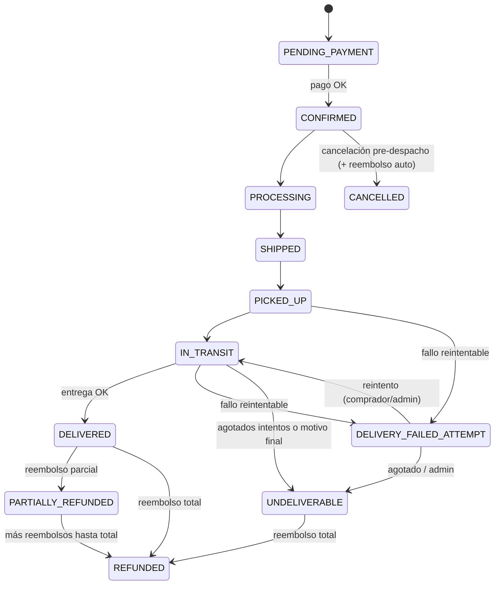

# Reembolsos y entregas fallidas — contrato API

Documentación para **web**, **backend** y **app móvil** ([`stuffsergio/nha-kinhon-mobile`](https://github.com/stuffsergio/nha-kinhon-mobile)).

## Variables de entorno

| Variable | Default | Descripción |
|----------|---------|-------------|
| `MAX_DELIVERY_ATTEMPTS` | `2` | Intentos fallidos antes de `UNDELIVERABLE` (salvo motivos no reintentables). |
| `BUYER_RESOLUTION_WINDOW_HOURS` | `72` | Ventana para corregir destinatario / reintento / cancelar con reembolso. |
| `REFUND_CLAIM_DAYS_AFTER_DELIVERY` | `7` | Días tras `DELIVERED` para reclamar daño/faltante. |
| `STRIPE_WEBHOOK_SECRET` | — | Obligatorio en producción. |
| `STRIPE_SECRET_KEY` | — | Solo servidor; **nunca** crear reembolsos reales en tests (mock). |

### Eventos Stripe (Dashboard → Webhook `/api/stripe/webhook`)

Además de los existentes (`payment_intent.succeeded`, `checkout.session.completed`, …), registrar:

- `charge.refunded`
- `refund.updated`
- `refund.failed`

Idempotencia: tabla `stripe_processed_events` (`eventId` único).

## Máquina de estados (resumen)



Motivos **no reintentables** (→ `UNDELIVERABLE` al primer registro): `RECIPIENT_REFUSED`, `PRODUCT_DAMAGED`.

## Modelos (Prisma)

- `DeliveryAttempt` — historial de fallos (reason, note, GPS, fotos).
- `OrderEvent` — auditoría de acciones (comprador, repartidor, admin).
- `Refund` — importe FCFA entero (XOF zero-decimal), estados `PENDING|SUCCEEDED|FAILED|CANCELED`.
- `AdminAuditLog` — acciones admin (aprobar/rechazar/reembolso manual/resolver).
- `StripeProcessedEvent` — webhooks idempotentes.

Migración: `20261012180000_refunds_failed_delivery`.

## Repartidor (rol DELIVERY) — contrato app móvil

Alineado con [`stuffsergio/nha-kinhon-mobile`](https://github.com/stuffsergio/nha-kinhon-mobile) (cola offline).

### `POST /api/delivery/orders/:id/failed-attempt`

**Cabecera obligatoria:** `X-Idempotency-Key: <UUID>` (v4). La app genera **un UUID por par repartidor + pedido** y lo reutiliza al reenviar desde la cola offline.

**Idempotencia (persistente):**

| Clave única en DB | `scope` + `actorId` (JWT repartidor) + `orderId` + `key` |
|-------------------|-------------------------------------------------------------|
| Tabla | `request_idempotency` |
| Scope | `delivery_failed_attempt` |
| Primer envío | Crea `DeliveryAttempt`, actualiza pedido, guarda **respuesta JSON completa** |
| Reintento misma clave | Devuelve la **misma respuesta** sin nuevo intento |
| Cabecera respuesta | `Idempotent-Replayed: true` en replays |
| Errores | `400 IDEMPOTENCY_KEY_REQUIRED` / `IDEMPOTENCY_KEY_INVALID` |

Body (allowlist):

```json
{
  "reason": "RECIPIENT_ABSENT",
  "note": "opcional",
  "lat": 11.86,
  "lng": -15.59,
  "photo": "data:image/jpeg;base64,...",
  "photos": ["..."]
}
```

`reason` ∈ `RECIPIENT_ABSENT|WRONG_ADDRESS|RECIPIENT_REFUSED|UNREACHABLE_PHONE|ACCESS_BLOCKED|PRODUCT_DAMAGED|OTHER`.

Respuesta **200** (también en replay idempotente):

```json
{
  "attempt": {
    "attemptNumber": 1,
    "reason": "RECIPIENT_ABSENT",
    "note": "…",
    "photos": [{ "url": "data:image/jpeg;base64,…" }],
    "createdAt": "2026-10-12T12:00:00.000Z"
  },
  "order": {
    "id": "…",
    "status": "DELIVERY_FAILED_ATTEMPT",
    "failedAttempts": [
      {
        "attemptNumber": 1,
        "reason": "RECIPIENT_ABSENT",
        "note": "…",
        "photos": [{ "url": "…" }],
        "createdAt": "2026-10-12T12:00:00.000Z"
      }
    ],
    "recipientName": "…",
    "items": []
  },
  "status": "DELIVERY_FAILED_ATTEMPT"
}
```

`order.status` usa alias móvil cuando aplica (`PREPARING`, `READY`, …) vía `formatDeliveryOrder`.

Rate limit: `deliveryFailureLimiter` (30 / 15 min).

### `GET /api/delivery/orders/:id/attempts`

Solo el repartidor **asignado** (`order.deliveryId === JWT user id`). Misma forma de intento que en `failedAttempts`:

```json
{
  "attempts": [
    {
      "attemptNumber": 1,
      "reason": "RECIPIENT_ABSENT",
      "note": null,
      "photos": [{ "url": "…" }],
      "createdAt": "2026-10-12T12:00:00.000Z"
    }
  ]
}
```

### `GET /api/delivery/orders/my`

Cada pedido incluye `failedAttempts[]` con el mismo shape (historial completo asc por `attemptNumber`).

Migración idempotencia compuesta: `20261012200000_idempotency_courier_order`.

## Comprador (rol USER)

| Método | Ruta | Descripción |
|--------|------|-------------|
| GET | `/api/orders/:id/history` | Intentos, eventos, reembolsos |
| PUT | `/api/orders/:id/recipient` | Corregir nombre/teléfono/dirección/coords |
| POST | `/api/orders/:id/reattempt` | Vuelve a `IN_TRANSIT` desde `DELIVERY_FAILED_ATTEMPT` |
| POST | `/api/orders/:id/refund-request` | Solicitud con `reason`, `buyerNote`, `orderItemIds?` |
| POST | `/api/orders/:id/cancel` | Borrador sin pago → `CANCELLED`; pre-despacho pagado → reembolso Stripe automático; incidencia → solicitud `UNDELIVERABLE` |

Cancelación automática con reembolso: pedido `CONFIRMED|PROCESSING|SHIPPED`, sin `deliveryId`, sin `pickedUpAt`.

## Admin

| Método | Ruta | Descripción |
|--------|------|-------------|
| GET | `/api/admin/incidents` | Pedidos `DELIVERY_FAILED_ATTEMPT` / `UNDELIVERABLE` |
| GET | `/api/admin/refunds?status=PENDING` | Cola de solicitudes |
| GET | `/api/admin/orders/:id/refund-summary` | `{ orderTotal, refundedSucceeded, refundableRemaining, refunds }` |
| POST | `/api/admin/refunds/:refundId/approve` | Body opcional `{ amount, adminNote }` — Stripe idempotency `nha-refund-{refundId}` |
| POST | `/api/admin/refunds/:refundId/reject` | `{ adminNote? }` → `CANCELED` |
| POST | `/api/admin/orders/:id/refund` | Reembolso manual `{ amount, reason?, adminNote?, orderItemIds? }` |
| POST | `/api/admin/orders/:id/resolve-undeliverable` | `{ outcome, amount?, adminNote? }` — `REFUND_FULL|REFUND_PARTIAL|REATTEMPT|CLOSE_NO_REFUND` |

Todas las rutas admin: `authenticate` + `requireAdmin` + rate limit `adminRefundLimiter`.

## Notificaciones

Plantillas i18n (`es`/`pt`/`pov`): `ORDER_DELIVERY_FAILED`, `ORDER_UNDELIVERABLE`, `ORDER_ASSIGNED_COURIER` (repartidor), `REFUND_*`, `ADMIN_REFUND_REQUEST`, `ADMIN_UNDELIVERABLE`.

Deep links sin cambios: `orderId`, `screen: "order_tracking"`, `route`, `url`.

## Seguridad

- Ownership / rol en cada handler (sin IDOR).
- Importes calculados en servidor; el cliente solo muestra `refundableRemaining`.
- Validación Zod (`backend/src/validations/refundsDelivery.js`).
- Auditoría admin en `admin_audit_logs`.

## Despliegue

1. `cd backend && npx prisma migrate deploy`
2. Regenerar cliente: `npx prisma generate`
3. Añadir eventos webhook Stripe listados arriba.
4. Opcional: ajustar `MAX_DELIVERY_ATTEMPTS`, ventanas de resolución/reclamo.

## Tests

`cd backend && npm test` — incluye elegibilidad, intentos, idempotencia webhook (mock), autorización y Stripe mockeado.
