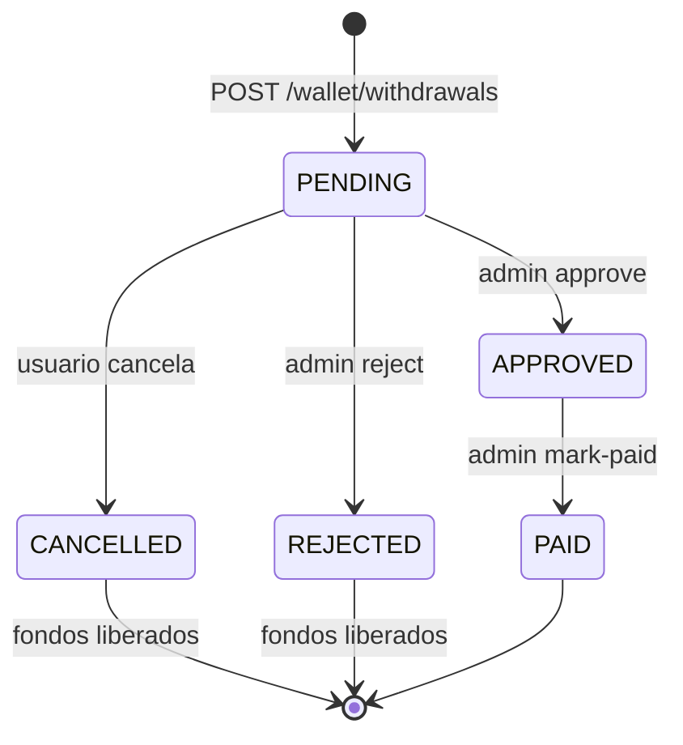

# Guía API — Billetera (XOF) y eliminación de cuenta

Documentación para implementar la billetera y el borrado de cuenta en clientes web/móvil. Todos los importes están en **unidades mínimas XOF (enteros)**, nunca en float.

## Conceptos

- **Billetera (`Wallet`)**: una por usuario, moneda `XOF`.
- **Libro mayor (`LedgerEntry`)**: asientos inmutables débito/crédito; el saldo se deriva de entradas `POSTED` menos retenciones `PENDING`.
- **Transacción (`WalletTransaction`)**: registro de negocio (depósito, transferencia, pago de pedido, retiro…) con estados `PENDING`, `COMPLETED`, `FAILED`, `CANCELLED`, `REVERSED`.
- **Retiro (`WithdrawalRequest`)**: solicitud admin con flujo manual de pago (Orange Money / MTN / banco).

### Diagrama de estados (retiro)



## Feature flag

La billetera solo responde si `WALLET_ENABLED=true` (u `1`, `yes`, `on`). Si está desactivada: `503` con código `WALLET_DISABLED`.

## Cabeceras comunes

| Cabecera | Cuándo |
|----------|--------|
| `Authorization: Bearer <accessToken>` | Todas las rutas autenticadas |
| `X-Idempotency-Key: <8-128 chars [A-Za-z0-9._-]>` | **Obligatoria** en depósitos, transferencias, retiros y pago de pedido con billetera |
| `Accept-Language: es \| pt \| pov` | Notificaciones y errores i18n |

## Variables de entorno (backend)

| Variable | Descripción | Default |
|----------|-------------|---------|
| `WALLET_ENABLED` | Activa la billetera | desactivado |
| `WALLET_DEPOSIT_MIN_MINOR` | Mínimo depósito | `500` |
| `WALLET_DEPOSIT_MAX_MINOR` | Máximo depósito | `5000000` |
| `WALLET_TRANSFER_MIN_MINOR` | Mínimo transferencia | `100` |
| `WALLET_TRANSFER_MAX_MINOR` | Máximo por transferencia | `500000` |
| `WALLET_TRANSFER_DAILY_LIMIT_MINOR` | Límite diario enviado | `1000000` |
| `WALLET_WITHDRAWAL_MIN_MINOR` | Mínimo retiro | `500` |
| `WALLET_WITHDRAWAL_MAX_MINOR` | Máximo retiro | `2000000` |
| `WALLET_AMOUNT_ABSOLUTE_MAX_MINOR` | Tope de seguridad | `2147483647` |

Stripe (depósitos): `STRIPE_SECRET_KEY`, `STRIPE_PUBLISHABLE_KEY`, `STRIPE_WEBHOOK_SECRET` — el crédito **solo** llega por webhook verificado.

---

## Eliminar cuenta

### `DELETE /api/auth/me`

Rate limit: 5/h por IP.

**Body (contrato app móvil PR #27)**

```json
{
  "confirmUsername": "Carlos Mendes"
}
```

- `confirmUsername`: nombre visible del usuario (`User.name`). Comparación **exacta** tras `trim()` en ambos lados.
- `password`: **opcional** (web puede enviarla); la app móvil no la envía.

**Éxito `200`**

```json
{
  "message": "Tu cuenta ha sido eliminada",
  "code": "ACCOUNT_DELETED",
  "deletedAt": "2026-10-28T12:00:00.000Z"
}
```

**Errores** (siempre incluyen `{ "error": "…", "code": "…" }`)

| Código | HTTP | Motivo |
|--------|------|--------|
| `USERNAME_MISMATCH` | 400 | `confirmUsername` (trim) ≠ `User.name` (trim) |
| `ACTIVE_ORDERS` | 409 | Pedidos activos (pago, confirmado o en reparto) |
| `WALLET_BALANCE` | 409 | Saldo o retenciones de billetera ≠ 0 |
| `ACCOUNT_DELETED` | 403 | Cuenta ya eliminada |
| `ACCOUNT_BLOCKED` | 403 | Cuenta bloqueada |
| `PASSWORD_WRONG` | 400 | Solo si se envió `password` y es incorrecta |

Efecto: soft-delete, PII anonimizada, tokens push/contactos borrados, refresh revocado; pedidos/pagos históricos conservados.

---

## Billetera — lectura

### `GET /api/wallet`

**Respuesta `200`**

```json
{
  "walletId": "clx…",
  "currency": "XOF",
  "balanceMinor": 15000,
  "availableMinor": 12000,
  "pendingHoldMinor": 3000,
  "limits": {
    "deposit": { "minMinor": 500, "maxMinor": 5000000 },
    "transfer": { "minMinor": 100, "maxMinor": 500000, "dailyLimitMinor": 1000000 },
    "withdrawal": { "minMinor": 500, "maxMinor": 2000000 }
  }
}
```

### `GET /api/wallet/transactions?cursor=&limit=20&type=&status=`

Paginación cursor. `limit` máx. 50.

Cada ítem incluye `withdrawalRequest` cuando `type` es `WITHDRAWAL` (o `null` en otros tipos):

```json
{
  "transactions": [
    {
      "id": "clx…",
      "type": "WITHDRAWAL",
      "status": "PENDING",
      "amountMinor": 10000,
      "withdrawalRequest": {
        "id": "clw…",
        "status": "PENDING",
        "method": "MOBILE_MONEY"
      }
    }
  ],
  "nextCursor": null
}
```

El cliente puede distinguir retiros **PENDING** (aún en revisión) de **APPROVED** (aprobado, pago manual pendiente) leyendo `withdrawalRequest.status` (no confundir con `WalletTransaction.status`, que permanece `PENDING` hasta el pago admin).

### `GET /api/wallet/recipients/lookup?q=maria@example.com`

Respuesta si existe (sin enumeración de emails):

```json
{ "found": true, "maskedName": "M••••" }
```

o `{ "found": false }`.

---

## Depósito (Stripe PaymentSheet)

### `POST /api/wallet/deposits`

**Body:** `{ "amount": 5000 }` (entero minor units)

**Respuesta `201`**

```json
{
  "walletTransactionId": "…",
  "amountMinor": 5000,
  "currency": "XOF",
  "paymentIntent": "pi_…_secret_…",
  "ephemeralKey": "ek_…",
  "customer": "cus_…",
  "publishableKey": "pk_test_…"
}
```

**Flujo móvil**

1. Llamar a este endpoint con `X-Idempotency-Key`.
2. Inicializar Stripe PaymentSheet con `paymentIntent`, `customer`, `ephemeralKey`, `publishableKey`.
3. **No** acreditar saldo en cliente; esperar push/notificación `WALLET_DEPOSIT_RECEIVED` o refrescar `GET /api/wallet`.
4. Backend acredita en `payment_intent.succeeded` con `metadata.type=wallet_deposit`.

---

## Transferencia

### `POST /api/wallet/transfers`

```json
{
  "recipient": "joao@example.com",
  "amount": 2000,
  "note": "Gracias"
}
```

`recipient`: email o teléfono de usuario existente. No puedes enviarte a ti mismo.

**Errores:** `WALLET_INSUFFICIENT_FUNDS`, `WALLET_TRANSFER_DAILY_LIMIT`, `WALLET_TRANSFER_SELF`, `WALLET_RECIPIENT_NOT_FOUND`.

---

## Retiro

### `POST /api/wallet/withdrawals`

```json
{
  "amount": 10000,
  "method": "MOBILE_MONEY",
  "destination": {
    "operator": "ORANGE_MONEY",
    "phone": "+245…",
    "accountName": "Carlos"
  }
}
```

`method`: `MOBILE_MONEY` | `BANK`. Retiene fondos (`pendingHoldMinor`) hasta resolución admin.

### `GET /api/wallet/withdrawals?cursor=&limit=20&status=`

Lista las solicitudes de retiro del usuario autenticado (paginación cursor, `limit` máx. 50). Filtro opcional `status`: `PENDING` | `APPROVED` | `REJECTED` | `PAID` | `CANCELLED`.

**Respuesta `200`**

```json
{
  "withdrawals": [
    {
      "id": "clw…",
      "walletTransactionId": "clx…",
      "status": "PENDING",
      "method": "MOBILE_MONEY",
      "amountMinor": 10000,
      "destination": { "operator": "ORANGE_MONEY", "phone": "+245…", "accountName": "Carlos" },
      "createdAt": "2026-10-28T12:00:00.000Z",
      "updatedAt": "2026-10-28T12:00:00.000Z",
      "reviewedAt": null,
      "paidAt": null
    }
  ],
  "nextCursor": null
}
```

### `POST /api/wallet/withdrawals/:id/cancel`

Cancela un retiro propio mientras `WithdrawalRequest.status` sea `PENDING`. Libera la retención en el libro mayor (asientos `PENDING` → `REVERSED`, transacción `CANCELLED`) dentro de una transacción con bloqueo de fila de billetera.

Requiere `X-Idempotency-Key` (mismo contrato que otras mutaciones).

**Respuesta `200`**

```json
{
  "withdrawalRequest": { "id": "…", "status": "CANCELLED", … },
  "walletTransaction": { "id": "…", "status": "CANCELLED", … },
  "idempotent": false
}
```

Si ya estaba `CANCELLED`, responde `200` con `"idempotent": true` (repetición segura). No permite cancelar retiros de otro usuario ni estados distintos de `PENDING`.

**Errores**

| Código | HTTP | Motivo |
|--------|------|--------|
| `NOT_FOUND` | 404 | Id inexistente o no pertenece al usuario |
| `WALLET_WITHDRAWAL_NOT_PENDING` | 409 | Estado `APPROVED`, `REJECTED`, `PAID`, etc. |
| `IDEMPOTENCY_KEY_REQUIRED` | 400 | Falta cabecera en cancelación |

### Admin

| Método | Ruta |
|--------|------|
| GET | `/api/admin/wallet/withdrawals?status=PENDING&cursor=` |
| POST | `/api/admin/wallet/withdrawals/:withdrawalId/approve` `{ "adminNote"?: "…" }` |
| POST | `/api/admin/wallet/withdrawals/:withdrawalId/reject` |
| POST | `/api/admin/wallet/withdrawals/:withdrawalId/mark-paid` `{ "payoutReference"?: "…" }` |

Auditoría en `AdminAuditLog`. Payout por defecto **manual** (`walletPayout.provider.js`).

---

## Pagar pedido con billetera

### `POST /api/orders/:id/pay-with-wallet`

Requiere pedido `PENDING_PAYMENT`, saldo disponible, `X-Idempotency-Key`.

**Respuesta `200`**

```json
{
  "order": { "id": "…", "status": "CONFIRMED", … },
  "walletTransaction": { "id": "…", "type": "ORDER_PAYMENT", "amountMinor": 12000 },
  "idempotent": false
}
```

## Reembolso a billetera (admin)

En `POST /api/admin/orders/:id/refund` body opcional:

```json
{ "amount": 5000, "refundToWallet": true }
```

Pedidos pagados con billetera (`stripePaymentId` prefijo `wallet:`) reembolsan a billetera automáticamente si la feature está activa.

---

## Notificaciones (push + bandeja)

| Tipo | Plantilla i18n |
|------|----------------|
| `WALLET_DEPOSIT_RECEIVED` | es / pt / pov |
| `WALLET_TRANSFER_SENT` / `WALLET_TRANSFER_RECEIVED` | es / pt / pov |
| `WALLET_WITHDRAWAL_APPROVED` / `REJECTED` / `PAID` | es / pt / pov |

Deep links: bandeja `/notificaciones` (sin `orderId`).

Push `data` y registros en bandeja incluyen, cuando aplica:

| Campo | Cuándo |
|-------|--------|
| `walletTransactionId` | Depósito, transferencias, retiros (aprobado/rechazado/pagado) |
| `withdrawalRequestId` | Notificaciones de retiro (`WALLET_WITHDRAWAL_*`) |

Ejemplo push retiro aprobado:

```json
{
  "type": "WALLET_WITHDRAWAL_APPROVED",
  "notificationId": "…",
  "walletTransactionId": "…",
  "withdrawalRequestId": "…",
  "url": "/notificaciones",
  "route": "/notificaciones"
}
```

La app móvil puede usar estos ids para refrescar `GET /api/wallet/withdrawals` o el detalle de movimientos.

---

## Checklist frontend

- [ ] Leer saldo desde `GET /api/wallet` (no usar `user.balance` legacy salvo compatibilidad).
- [ ] Enviar `X-Idempotency-Key` UUID v4 en cada mutación.
- [ ] PaymentSheet depósito: no optimizar saldo local sin webhook.
- [ ] Lookup destinatario antes de confirmar transferencia.
- [ ] UI retiros: listar con `GET /api/wallet/withdrawals`; cancelar PENDING con `POST …/cancel`; estados PENDING / APPROVED / PAID / REJECTED / CANCELLED.
- [ ] En movimientos, usar `withdrawalRequest.status` en ítems `WITHDRAWAL`.
- [ ] Notificaciones wallet: leer `walletTransactionId` / `withdrawalRequestId` del push o bandeja.
- [ ] Manejar `503 WALLET_DISABLED` ocultando sección billetera.
- [ ] Flujo borrar cuenta: confirmar nombre exacto + contraseña; bloqueos 409.
- [ ] Formatear XOF como entero con separadores locales.
- [ ] Polling 5–10 s tras depósito opcional; preferir push.

---

## Códigos de error billetera (resumen)

`WALLET_DISABLED`, `WALLET_INSUFFICIENT_FUNDS`, `WALLET_AMOUNT_*`, `WALLET_TRANSFER_*`, `WALLET_WITHDRAWAL_*` (incl. `WALLET_WITHDRAWAL_NOT_PENDING`), `IDEMPOTENCY_KEY_*`, `ACCOUNT_*`.
